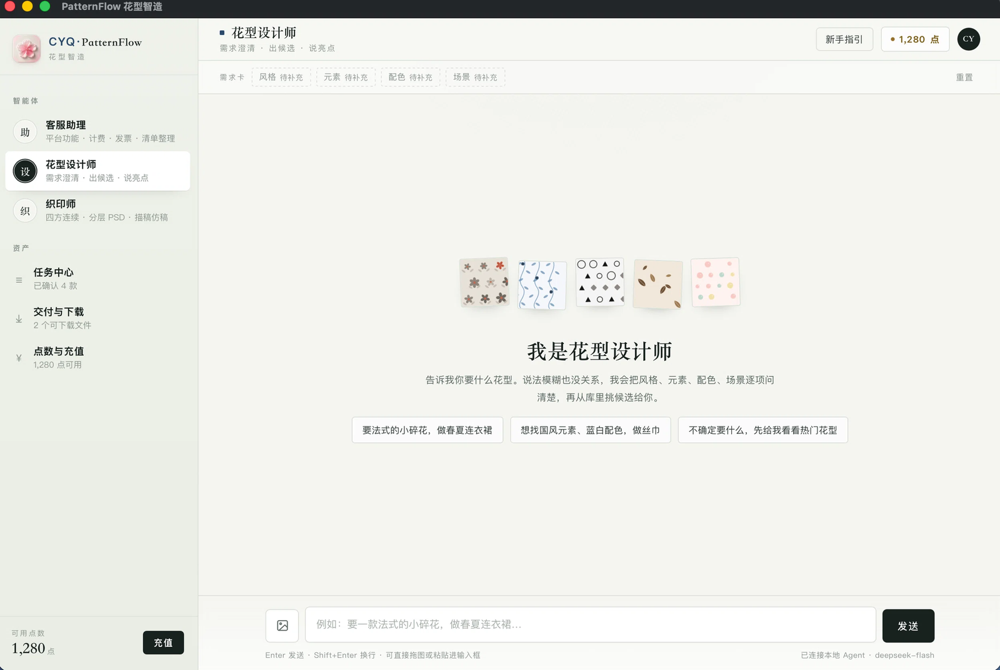

<div align="center">

# CYQ·PatternFlow · 花型智造

**把一句模糊的需求，或一张面料照片，变成可以印上布的花型。**

面向服装面料的 AI 花型工作台：需求澄清 → 候选/生成 → 四方连续 → 分层 PSD，
外加客服计费与运营后台。默认本地运行，数据不出本机。

[](#快速开始)
[](#算法模块)
[](#桌面端)
[](LICENSE)

</div>



---

## 这是什么

PatternFlow 是一个「能落到印花厂」的花型生产工具，而不是单纯的 AI 画图玩具：

- **花型设计师**：用聊天把风格 / 元素 / 配色 / 场景问清楚，从花型库里挑候选，或按需求生成新的无缝花型；
- **织印师**：面料照片描稿（去褶皱、阴影、透视）→ 四方连续（逐像素接缝校验）→ 300dpi 分层 PSD；
- **客服助理**：计费、充值、发票、任务与下载清单；
- **运营后台**：模型与密钥、花型库、会话记录、用量分析。

核心约束：**所有生成结果都要能平铺、能印刷、能交付**。算法侧会做接缝检查、密度检查、
分层校验；失败会明确告诉用户原因，而不是给一张「看起来还行」的图。

## 功能一览

| 模块 | 能做什么 | 产出 |
| --- | --- | --- |
| 花型设计师 | 需求澄清、候选推荐、纯算法生图（4/6/9 版） | 无缝单元、平铺预览、说明 |
| 织印师 · 描稿 | 面料照片 AI 清洗，保留花型、去褶皱阴影 | 干净平铺稿 |
| 织印师 · 四方连续 | 接缝对齐、可选 AI 缝带 / 生成式重排 | 无缝花版 + 接缝报告 |
| 织印师 · 分层 PSD | 300dpi 分色，根层 + Colors 分组，蒙版保留原始像素 | 可印刷 PSD |
| 客服助理 | 点数额度、支付二维码、发票信息、交付清单 | 账单/清单 |
| 运营后台 | 密钥与模型、花型库扫描、会话回放、数据分析 | 后台面板 |
| macOS 桌面端 | 原生窗口 + 自动拉起本地服务 | `.app` |

更多界面见 [docs/screenshots](docs/screenshots)。

## 架构

```
┌──────────────────────────── 浏览器 / macOS 桌面端 ────────────────────────────┐
│  前端/PatternFlow…v0.7.html        （C 端，用户对话）                          │
│  后端静态服务直接托管同一份单文件页面                                            │
└───────────────┬──────────────────────────────────────────────┬────────────────┘
                │ /api/chat  /api/action  /api/state           │ 静态页面
┌───────────────▼──────────────────┐              ┌────────────▼───────────────┐
│ 后端/server.py  :8787            │              │ 后台/admin_server.py :8788 │
│  · LLM 对话 + 工具调用            │              │  · 模型/密钥/花型库/会话    │
│  · Skill 注册 + confirm 闸门      │              │  · 独立口令与进程            │
│  · 任务/计费/交付/文件            │              └────────────────────────────┘
│  · 算法桥 core/algo.py           │
└───────────────┬──────────────────┘
                │ subprocess（本地、可离线）
     ┌──────────┼──────────────────────────┬─────────────────────────┐
     ▼          ▼                          ▼                         ▼
 花型生成     描稿/四方连续/分层 PSD      自动打标签               全网搜花型
 (纯算法)     (Node + Python + 图像 API)  (本地小模型)             (Playwright)
```

设计要点：

- **本地优先**：后端只用 Python 标准库，没有 Web 框架依赖；页面是单文件 HTML；算法以子进程运行，互不影响。
- **confirm 闸门**：所有扣费动作先返回 `need_confirm`，用户在卡片上点确认后才会真正执行；避免模型擅自花钱。
- **技能化**：每个能力由 `skills/<name>/skill.json` + `handler.py` 描述，LLM 只负责选技能和填参数，业务逻辑在 handler 里。
- **算法可替换**：`core/algo.py` 是统一桥接层，负责运行时发现、离线/代理、超时与错误摘要。
- **双端独立**：C 端与 B 端是两个进程，后台挂了不影响用户聊天。

更细的设计见 [docs/ARCHITECTURE.md](docs/ARCHITECTURE.md)。

## 快速开始

### 环境

- **Python 3.10+**（后端与前台服务只依赖标准库）
- **macOS / Linux**；桌面端需要 macOS 12+ 与 Xcode Command Line Tools
- 需要联网调用 LLM；图像算法需要额外运行时（见 [算法模块](#算法模块)）

### 1. 启动前后台

```bash
git clone https://github.com/CYQ131515/fabric-pattern-agent.git
cd fabric-pattern-agent

# 方式 A：一键（macOS 双击或终端执行）
./启动全部.command

# 方式 B：分别启动
python3 后端/server.py --port 8787      # C 端
python3 后台/admin_server.py --port 8788 # B 端（可选）
```

打开：

- 用户端 <http://127.0.0.1:8787/>
- 运营后台 <http://127.0.0.1:8788/>（首次进后台设置口令）

### 2. 配置密钥

```bash
cp 后端/config/secrets.example.json 后端/config/secrets.json
```

编辑 `后端/config/secrets.json`（该文件已被 `.gitignore` 排除）：

| 字段 | 用途 |
| --- | --- |
| `api_key` | 对话/视觉模型（默认 DeepSeek OpenAI 兼容接口） |
| `image_api_key` | 纯算法失败时的兜底生图（默认火山方舟） |
| `seamless_api_key` | 描稿/四方连续/PSD 流水线的图像 API（APIMART） |
| `runninghub_api_key` | 可选：RunningHub 工作流（SAM3 抠图等） |
| `admin_password` | 运营后台口令 |

不配置密钥也能启动，只是模型相关能力不可用；页面与本地算法仍可工作。

### 3. 桌面端（可选）

```bash
cd 桌面端
./构建.command              # 构建到 桌面端/PatternFlow.app
./安装到应用程序.command      # 安装到 /Applications 并注册 Spotlight
```

桌面端是一个原生 WKWebView 壳：自动检测/启动 `127.0.0.1:8787`，管理后台按需启动；
如果端口被别的应用占用会自动顺延；退出时只关闭自己拉起的进程。详见 [桌面端/README.md](桌面端/README.md)。

## 目录结构

```
├── 前端/                     # 单文件前端（当前 v0.7 + 历史版本）
├── 前端新版/                  # v1.0（与 v0.7 同源，样式/脚本同步）
├── 后端/
│   ├── server.py            # C 端 HTTP 服务（标准库）
│   ├── core/                # 配置、LLM、技能、任务、算法桥、图像…
│   ├── skills/              # 每个能力的 skill.json + handler.py
│   ├── personas/            # 三个角色的系统提示词
│   ├── data/                # 演示花型/趋势/词表（矢量，无真实图片）
│   └── 测试/                 # Python + jsdom 回归
├── 后台/                     # B 端服务与后台页面
├── 算法/
│   ├── 花型生成/             # pattern_studio：纯算法生图（numpy + Pillow）
│   ├── 描稿-四方连续-psd分层/  # 面料→无缝→分层 PSD 流水线
│   ├── 自动打标签/            # 本地小模型打标（权重需自行下载）
│   ├── 全网搜花型/            # 可选：Playwright 采风
│   ├── 四方连续/ · psd分层/   # 旧版算法（保留兼容）
├── 桌面端/                   # Swift + WKWebView 原生壳
├── docs/                     # 架构/配置/算法/开发文档
└── 数据/                     # 本地数据（不在仓库里，首次运行生成）
```

## 配置说明

完整字段见 [docs/CONFIGURATION.md](docs/CONFIGURATION.md)，常用环境变量：

| 变量 | 默认 | 说明 |
| --- | --- | --- |
| `PATTERNFLOW_PORT` | `8787` | C 端端口 |
| `PATTERNFLOW_ADMIN_PORT` | `8788` | B 端端口 |
| `PATTERNFLOW_PYTHON` | 自动探测 | 指定 Python 解释器 |
| `HTTPS_PROXY` / `HTTP_PROXY` | 系统代理 | 算法子进程会自动继承可用代理；Node 会带 `--use-env-proxy` |

> 如果你的 VPN 是「系统代理」模式，PatternFlow 会自动探测 127.0.0.1 上的代理端口并注入给算法；
> 代理不可用时会强制直连，避免死代理把请求拖死。

## 算法模块

三个算法都是**独立子进程**，可以单独启用/替换。

### 花型生成（默认可用）

纯算法绘制花型（SVG 渲染到 PNG），不消耗图像 API；输出可平铺的无缝单元。
需要本地虚拟环境：

```bash
cd 算法/花型生成
./安装.command           # 创建 .venv（numpy + Pillow），支持离线
```

### 描稿 / 四方连续 / 分层 PSD

Node 24 脚本 + Python 3.13（uv/PSD 工具链）+ 图像生成 API，负责：

1. `01-clean` 清洗面料照片（去褶皱/阴影，保留花型）
2. `02-seam-*` 接缝修复 / 生成式重排
3. `03-seamless` 接缝审查与回退
4. `04-psd` 300dpi 分色分层 PSD

依赖与安装步骤见 [算法/描稿-四方连续-psd分层/README.md](算法/描稿-四方连续-psd分层/README.md)，
以及 [docs/ALGORITHMS.md](docs/ALGORITHMS.md)。

### 自动打标签 / 全网搜花型（可选）

- 自动打标签：需要本地模型权重（仓库不包含，按该目录 README 下载）；
- 全网搜花型：Playwright 采集，默认关闭；需要自备配置。

## 桌面端

原生 macOS 窗口，不是浏览器套壳：

- 自动检测/启动本地后端，日志在 `~/Library/Logs/PatternFlow/`；
- 菜单：刷新（⌘R）、浏览器打开（⌘⇧O）、重启服务（⌘⇧R）、管理后台（⌘⇧A）；
- 支持原生文件选择面板；退出只停自己拉起的进程；
- 构建、安装和截图自检见 [桌面端/README.md](桌面端/README.md)。


## 测试

```bash
# Python 后端
cd 后端
python3 测试/test_algo_bridge.py
python3 测试/test_trace_skill.py
python3 测试/test_psd_cache.py
python3 测试/test_patgen.py

# 前端 jsdom（需要 Node + jsdom）
cd ..
node 后端/测试/test_v07_client.mjs

# 指定另一个前端页面
PF_CLIENT_HTML=前端新版/PatternFlow花型智造-新版v1.0.html node 后端/测试/test_v07_client.mjs
```

当前基线：前端两页各 **162 通过 / 0 失败**；后端算法/技能/缓存相关用例全绿。
完整回归脚本见 `后端/测试/`。

## 数据与隐私

- `后端/config/secrets.json`、`**/.env`、`数据/`、`**/.runtime`、`**/.venv`、模型权重、
  PSD 交付物都已加入 `.gitignore`，不会进入仓库；
- 花型库图片、上传的原图、会话记录全部保存在本地 `数据/` 下；
- 仓库内的 `后端/data/patterns.json` 是**程序生成的演示花型**（矢量绘制，没有真实照片）；
- 发现安全问题请见 [SECURITY.md](SECURITY.md)。

## 已知限制

- 目前是**单机单用户**设计：没有账号体系、并发队列和云端存储；
- 前端是单文件 HTML（这是刻意的取舍：部署简单、离线可用），页面体积较大；
- 图像算法依赖第三方 API，速度和成本取决于所选的图像模型；
- 桌面端目前只支持 macOS；
- 自动打标签与全网搜花型属于可选模块，默认不参与主流程。

## Roadmap

- [ ] 把算法运行时安装做成一条命令（Node/sharp/uv/模型）
- [ ] 任务队列与多用户配额
- [ ] Windows / Linux 桌面端
- [ ] 更完整的 PSD 分层校验报告
- [ ] 前后端拆包（保留单文件构建产物）

## License

[MIT](LICENSE) © 2026 CYQ

## 致谢

- 花型生成算法与「描稿 → 四方连续 → 分层 PSD」流水线来自本项目长期迭代；
- 前端视觉方向：织物样本册 / 织造工作室；
- 感谢所有在真实面料上验证过这些花型的人。

---

<sub>English: PatternFlow is a local-first studio for textile pattern production — chat-driven pattern design,
seamless tiling, and print-ready layered PSDs. Backend is standard-library Python; frontend is a single-file
HTML app; algorithms run as replaceable subprocesses. MIT licensed.</sub>
